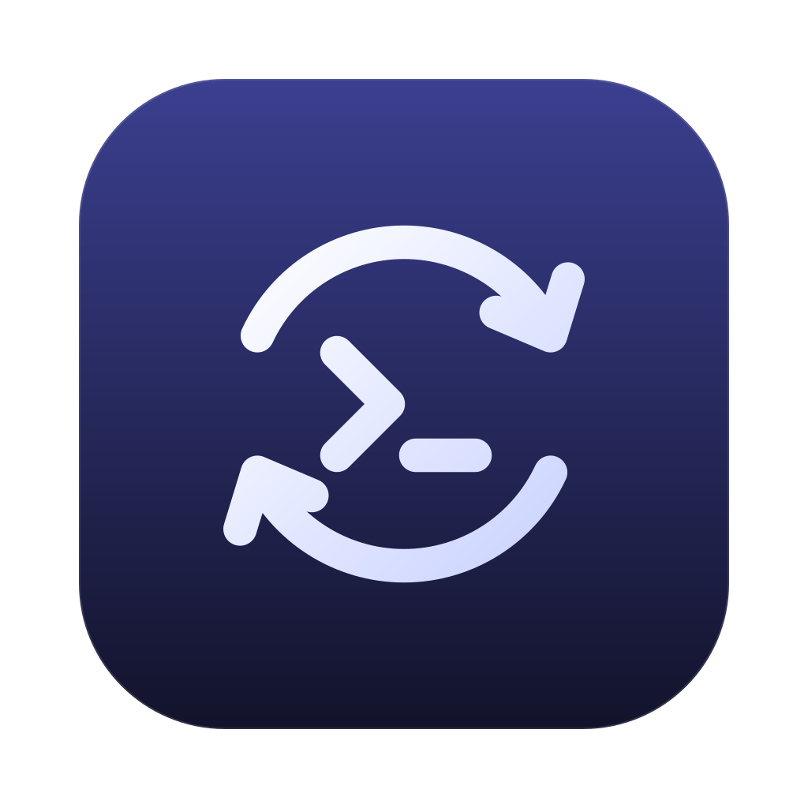
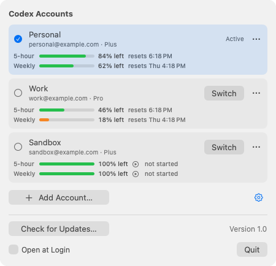

<p align="center">
  
</p>

<h1 align="center">Codex Switcher</h1>

<p align="center">
  Your ChatGPT accounts, one click apart.<br>
  A small macOS menu-bar app for switching the Codex desktop app between saved accounts.
</p>

<p align="center">
  <a href="https://github.com/Golps/CodexSwitcher/releases/latest"><strong>Download for macOS →</strong></a><br>
  Apple Silicon · macOS 13 or later · Version 1.0
</p>

<p align="center">
  <picture>
    <source media="(prefers-color-scheme: dark)" srcset="assets/screenshots/menu-dark.png">
    
  </picture>
  <br>
  <sub>Actual app views rendered with fictional accounts and sample usage. No real account data is shown.</sub>
</p>

## Switch accounts without signing out

Add each account once, then choose **Switch** from the menu bar. Codex Switcher saves your logins locally, changes the login used by Codex, and reopens Codex if it was running.

- **See what is left.** Five-hour and weekly usage meters show each account’s remaining allowance and reset time.
- **Keep accounts separate.** Add an account through a separate sign-in session without replacing the login Codex is currently using.
- **Use familiar macOS controls.** Light and dark appearance, inline settings, optional launch at login, and no Dock window.
- **Keep logins on your Mac.** Saved account credentials are stored in the macOS login Keychain.
- **Update from the menu.** Open settings and choose **Check for Updates…**.

> Switching force-quits Codex when it is running. Finish or stop active tasks before switching. Terminal and editor sessions may need to be restarted separately.

## Install

**Requirements:** an Apple Silicon Mac, macOS 13 or later, and the Codex desktop app. Intel Macs are not supported by this build.

1. Download **CodexSwitcher.dmg** from the [latest release](https://github.com/Golps/CodexSwitcher/releases/latest).
2. Open the disk image and drag **Codex Switcher** into **Applications**.
3. Open the app. Its icon appears in the menu bar.

The current release uses a self-signed certificate and is not notarized by Apple. macOS may require you to approve opening it in **System Settings → Privacy & Security**. Only approve a download you trust.

If an existing installation reports a higher version number, install this fresh 1.0 release manually; the update checker does not offer downgrades.

## Use

1. Open the menu. The account currently signed in to Codex is saved automatically when its file-based login is available.
2. Choose **Add Account…** and sign in to another ChatGPT account. Repeat for any additional accounts.
3. Choose **Switch** beside the account you want to use.

The **⋯** menu lets you rename or remove a saved account. Switch away from the active account before removing it.

The **gear** reveals settings inside the same panel: **Check for Updates…**, **Open at Login**, and **Quit**.

### Read the usage meters

Meters show **the percentage left**, not the percentage used. Green changes to orange at 30% remaining and red at 10% remaining.

| Display | Meaning |
| --- | --- |
| **5-hour** | Remaining allowance for the short usage window reported by Codex |
| **Weekly** | Remaining allowance for the weekly window |
| **not started** | The app treats a window with 100% remaining as not started |
| **resets …** | The reset time reported for that window |

Usage is requested when the menu opens, with a minimum five-second interval between checks. While the menu stays open, it refreshes every 30 seconds. These values depend on OpenAI’s account and usage interfaces and may change if those interfaces change.

## Privacy and account storage

- Saved logins are kept in the **Codex Switcher** item in your macOS login Keychain.
- Switching writes the chosen login to Codex’s local `~/.codex/auth.json` file. The outgoing login is retained in the local Keychain store.
- Account credentials are sent to OpenAI when needed for sign-in, refresh, and usage requests. They are not sent to this project’s GitHub repository.
- GitHub is contacted to check for and download application updates.
- Sign-in callbacks are received locally at `127.0.0.1`.

The app’s network integrations are OpenAI sign-in (`auth.openai.com`), ChatGPT usage (`chatgpt.com`), and GitHub’s API/download services. There is no project analytics or telemetry implementation in the application source.

Because Codex Switcher manages account credentials, only run builds and source you trust. Never include your local account files, Keychain exports, or real credentials in an issue or pull request.

## Troubleshooting

**macOS asks for Keychain access.** Approve access only for the app you installed and trust. macOS may ask again after an update, including when the signing identity changes.

**Codex uses Keychain login instead of a file.** The menu offers **Use File Login** when it detects this configuration. You may need to sign in to Codex again afterward.

**A terminal or editor still uses the old account.** Restart that session. Switching the desktop app does not change the credentials already loaded by another running session.

**Usage says the sign-in expired.** For the active account, open Codex to refresh its login. For another saved account, remove it and add it again.

**Another sign-in is already running.** Finish or close any `codex login` session before using **Add Account…**; both use the same local callback port.

**The update checker asks for a GitHub token.** The public repository should not require one. This prompt exists for private-repository access; do not paste an OpenAI key into it.

**Remove the app.** Quit it, disable **Open at Login** if enabled, and move the app to the Trash. To remove its saved account vault as well, delete the **Codex Switcher / accounts** item in Keychain Access. This does not sign Codex out of its current local login.

## Build and maintain

Install Apple’s Command Line Tools, then:

```sh
./scripts/build.sh          # build/Codex Switcher.app
./scripts/build.sh --dmg    # also creates build/CodexSwitcher.dmg
```

There are no third-party runtime dependencies. Local builds are ad-hoc signed unless `SIGN_IDENTITY` selects a certificate already available in your Keychain. Set `SDKROOT` to an installed compatible macOS SDK if needed.

Run the native settings check:

```sh
mkdir -p work
xcrun swiftc -D DEBUG -parse-as-library -target arm64-apple-macos13.0 \
  -module-cache-path work/module-cache -o work/check-settings \
  Sources/SettingsFooter.swift Sources/StatusPanelWindow.swift Tests/SettingsLayout.swift
work/check-settings
```

### Reproduce the screenshots safely

```sh
./scripts/capture-screenshots.sh
```

This compiles the production menu views with a synthetic model from `Tests/ScreenshotFixture.swift`. The fixture does not compile the account store, sign-in flow, or networking implementation. It renders only its own view into the PNGs; it does not take a desktop screenshot or read real accounts.

### Publication checks

Use a reviewed publication directory containing only source, resources, documentation, and intended assets. Install [Gitleaks](https://github.com/gitleaks/gitleaks), then run:

```sh
python3 scripts/check-privacy.py PATH_TO_PUBLICATION_DIRECTORY --require-gitleaks
```

For a fresh Git repository, also pass `--git-metadata`. The check rejects private working files, user-home paths, personal email providers, known credential patterns, and unapproved Git identities. Gitleaks adds credential detection. Manual review is still required for images, metadata, and sensitive context that pattern matching cannot recognize.

The release workflow builds and validates the app before publishing. Release-signing credentials belong in GitHub Actions secrets, never in source or release assets.

### Source layout

| Directory | Purpose |
| --- | --- |
| `Sources/` | Application, account handling, usage, updater, and menu views |
| `Resources/` | Application metadata and icon |
| `Tests/` | Native settings checks and isolated screenshot fixture |
| `scripts/` | Build, screenshot rendering, and publication privacy checks |
| `assets/` | Editable icons and synthetic README screenshots |

---

<sub>Codex Switcher is an independent project and is not affiliated with or endorsed by OpenAI. It relies on Codex authentication and usage interfaces whose compatibility may change.</sub>
